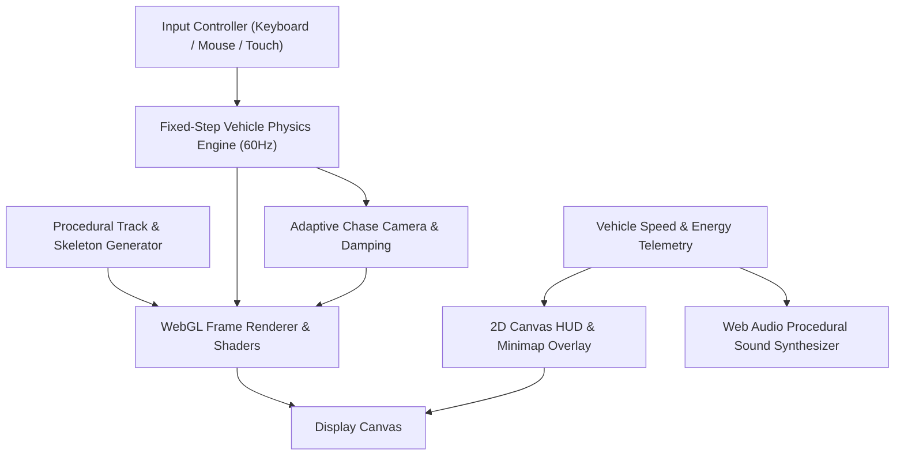

# 🏎️ 3D Anti-Gravity Racing Game (SP13KTRA)

<div align="center">
  

  <p align="center">
    <a href="https://ghalibhussainnoohani.github.io/3d-racing-game/"></a>
    
    
    
  </p>

  <p align="center">
    <strong>Full-spectrum 3D anti-gravity racing game with real-time physics, dynamic lighting, procedural audio synthesis, and custom circuit tracks.</strong>
  </p>
</div>

---

## 🎮 [▶ Play the Live Game in Your Browser](https://ghalibhussainnoohani.github.io/3d-racing-game/)

---

## 🕹️ Controls & Mechanics

| Action | Primary (Mouse) | Alternative (Keyboard) |
| :--- | :--- | :--- |
| **Accelerate** | Left Mouse Button | `W` or `Up Arrow` |
| **Steer** | Mouse Left / Right | `A` / `D` or `Left` / `Right Arrow` |
| **Turbo Boost** | Right Mouse Button | `Left Shift` |
| **Brake** | Middle Mouse Button | `Spacebar` |
| **Toggle Music** | `M` | `M` |

- **Circuit Selection:** Click a circuit on the menu to select, click again to race.
- **Team Customization:** Click **TEAM** in the menu to cycle between anti-gravity craft.

---

## 🏁 Gameplay Rules & Physics

- **Energy Shield & Turbo:** Turbo boost draws energy from your shield meter. Recharge on rainbow track strips; collisions and wall friction cost shield energy.
- **Boost Pads:** Yellow track pads trigger instant hyper-acceleration.
- **Braking into Corners:** Release the accelerator when initiating sharp turns to bank deeply and maintain traction.
- **Minimap & Telemetry:** Real-time track minimap tracks every rival racer's position, lap splits, and speed.

---

## 🦄 Key Features

- **Real-Time 3D WebGL Engine:** Dynamic track geometry, banked curves, arch tunnels, and figure-eight crossovers rendered directly in the browser.
- **Procedural Audio Synthesizer:** Real-time synthesized techno soundtrack generated algorithmically from unique circuit seeds.
- **Dynamic Skyboxes & Atmospheric Fog:** Suns, eclipses, celestial skyboxes, and customized particle clouds for each circuit.
- **Rival AI Racers:** Competitive autonomous AI craft navigating realistic racing lines.
- **Local Persistence:** Best lap records and unlocked circuits persisted locally.

---

## 💻 Tech Stack & Architecture

```yaml
Graphics Engine: WebGL / Three.js
Audio: Web Audio API (Procedural Synthesizer)
Language: JavaScript (Modern ES6+)
Build Tool: Vite
Author: Ghalib Hussain (@ghalibhussainnoohani)
Original Concept: JS13k SP13KTRA by Frank Force
```

### 📐 Engine Architecture



---

## 🚀 Running Locally

1. **Clone the repository:**
   ```bash
   git clone https://github.com/ghalibhussainnoohani/3d-racing-game.git
   cd 3d-racing-game
   ```

2. **Install dependencies:**
   ```bash
   npm install
   ```

3. **Start local dev server:**
   ```bash
   npm run dev
   ```
   Open `http://localhost:5173` in your browser.
